# 水 Space（MizuSpace）

**SuiPlay0X1 用の非公式ランチャー**
Windows 化した SuiPlay0X1 を、ゲーム機らしく快適に使うためのアプリです。

*An unofficial launcher for SuiPlay0X1 running Windows 11.*
[English](#english) ・ [简体中文](#简体中文) ・ [한국어](#한국어)

> [!NOTE]
> 現在開発中です（Ver. 0.8 系をテスト中）。配布を始めるときは、このページの Releases でお知らせします。

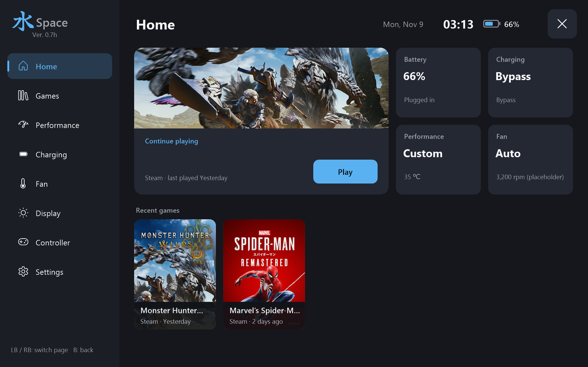

---

## 水 Space でできること

### 🏠 ホーム画面
- 本体のホームボタンで、いつでもホーム画面を呼び出せます
- Steam・Epic Games・GOG のゲームを表紙付きで一覧にして、そのまま起動
- ゲームを閉じると、元の操作状態に自動で戻ります

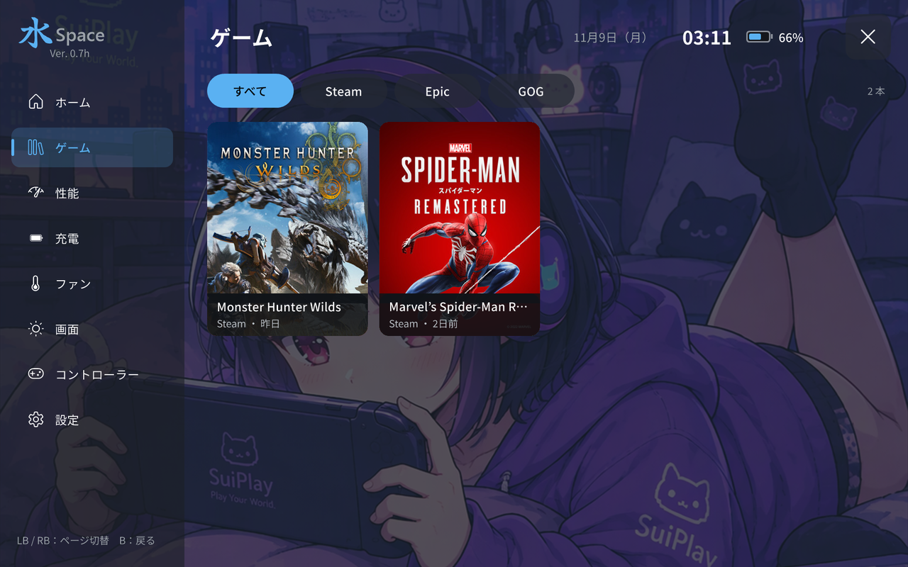

### ⚡ クイック設定
本体の「水」ボタンを押すと、画面の右からパネルがスライドして出てきます。ゲーム中でもすぐ変更できます。

| タブ | できること |
|---|---|
| 性能 | 省電力／バランス／性能のプリセット、消費電力（TDP）の細かい調整、FPS 制限 |
| デバイス | 明るさ・音量・リフレッシュレート・解像度、Wi-Fi・Bluetooth・機内モード |
| 操作 | コントローラーでのパソコン操作、ボタンの割り当て |
| 電池 | バイパス充電、充電上限 |
| システム | テーマ・言語・背景画像など |

<table><tr>
<td>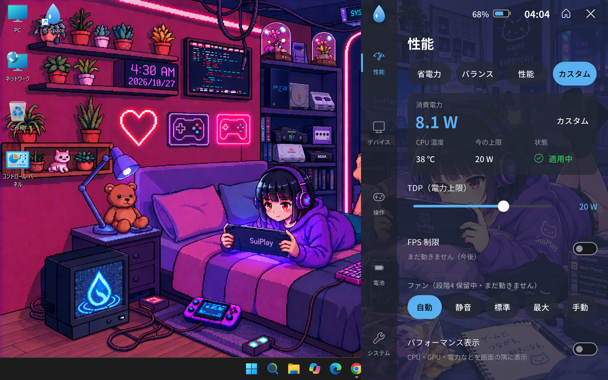</td>
<td>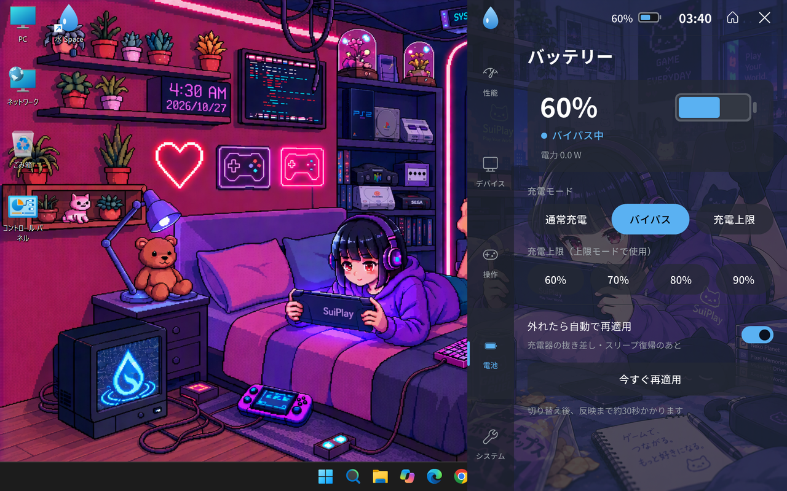</td>
</tr><tr><td align="center">性能タブ</td><td align="center">電池タブ</td></tr></table>

### 🎯 FPS 制限
- クイック設定のスイッチひとつで、FPS の上限をオン／オフ
- 30／40／45／60 FPS から選べます。電池を長持ちさせたいときや、本体の発熱を抑えたいときに
- AMD のドライバ標準の機能を使うので、ゲームごとの設定はいりません

### 🔋 バイパス充電・充電上限
- 充電器をつないだまま遊ぶときに、バッテリーへの負担を減らす「バイパス充電」
- 60／70／80／90% で充電を止める「充電上限」
- 充電器の抜き差しやスリープからの復帰のあとも、自動でかけ直します
- アプリを終了すると、必ず通常の充電に戻ります

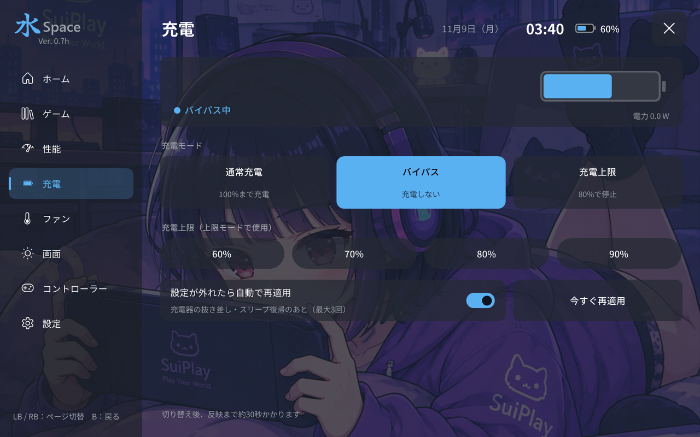

### 🎮 コントローラーでパソコン操作
- スティックでマウス、ボタンでクリック。デスクトップもコントローラーだけで操作できます
- ボタンの割り当ては自分で変えられます
- ディスプレイキーボードもワンタッチで呼び出し

### 📊 パフォーマンス表示
- FPS・CPU・GPU・メモリ・消費電力・温度・電池残量・時刻を、画面の隅に表示
- 表示位置と背景の濃さを選べます

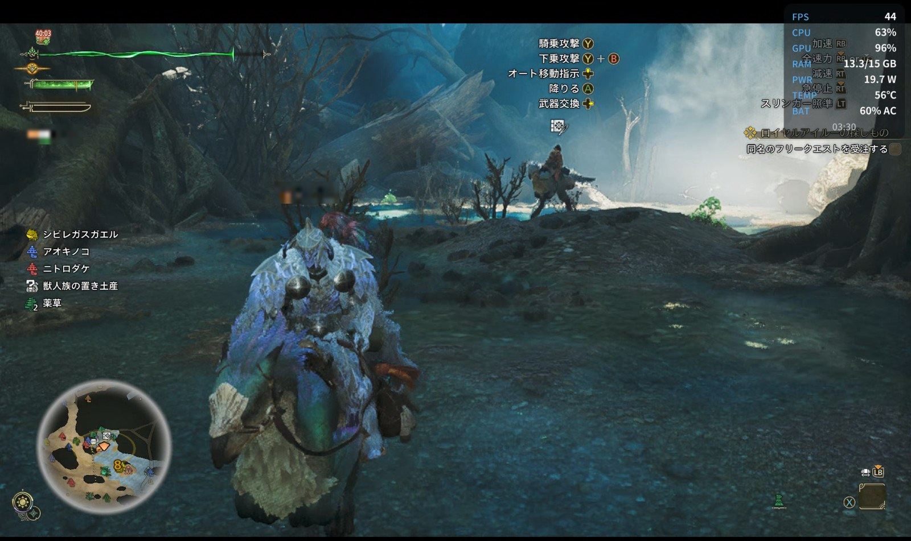

右上がパフォーマンス表示です。

### 🩺 動作チェック・ドライバチェック
- ボタン・スティック・振動の動作確認
- ドライバの状態を診断し、古いものや足りないものがあれば公式のダウンロードページへ案内します（勝手にドライバを入れることはしません）

<table><tr>
<td></td>
<td>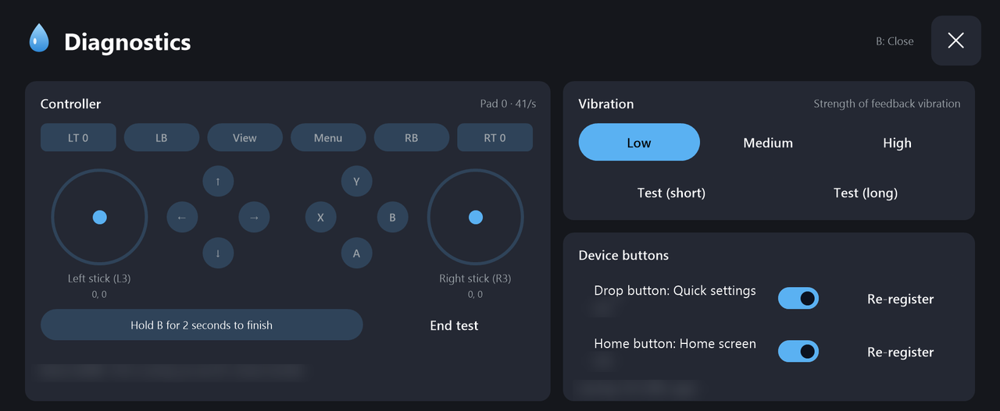</td>
</tr><tr><td align="center">ドライバチェック</td><td align="center">動作チェック</td></tr></table>

### 🎨 見た目
- テーマはダーク／ライト／Windows に合わせる、から選べます
- 好きな画像をガラス越しのような背景にできます。ホーム画面とクイック設定で、見せる位置・拡大・ぼかしを別々に調整
- 8 言語対応：日本語・English・简体中文・繁體中文・한국어・Español・Français・Deutsch

<table><tr>
<td>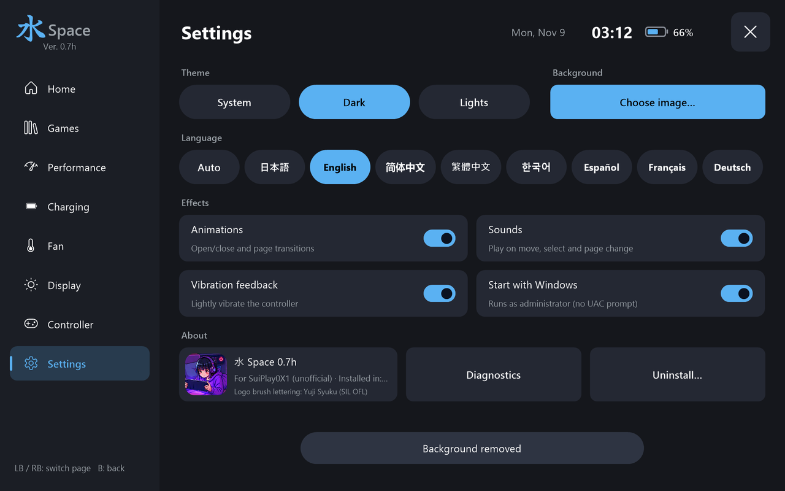</td>
<td>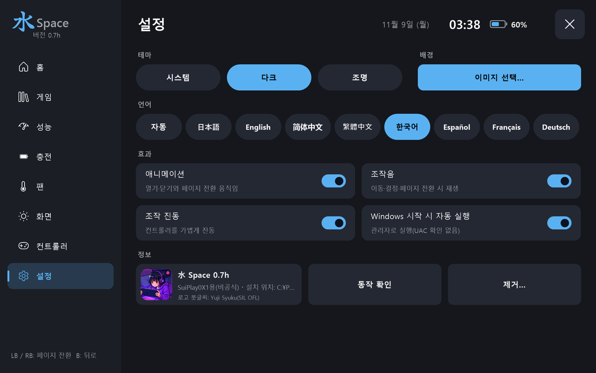</td>
<td>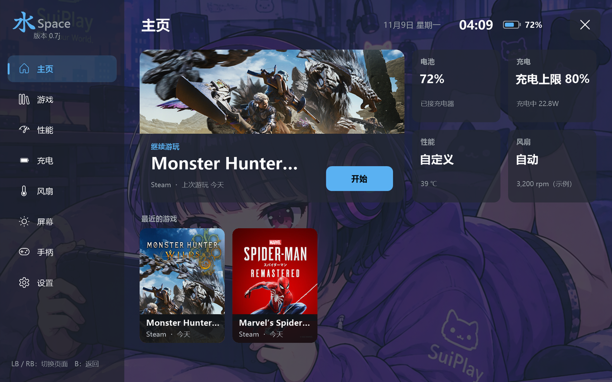</td>
</tr><tr><td align="center">English</td><td align="center">한국어</td><td align="center">简体中文</td></tr></table>

### 📦 かんたんインストール
- exe 1 つで、インストール・更新・アンインストールができます
- Windows の起動時に自動で立ち上がります（オフにもできます）

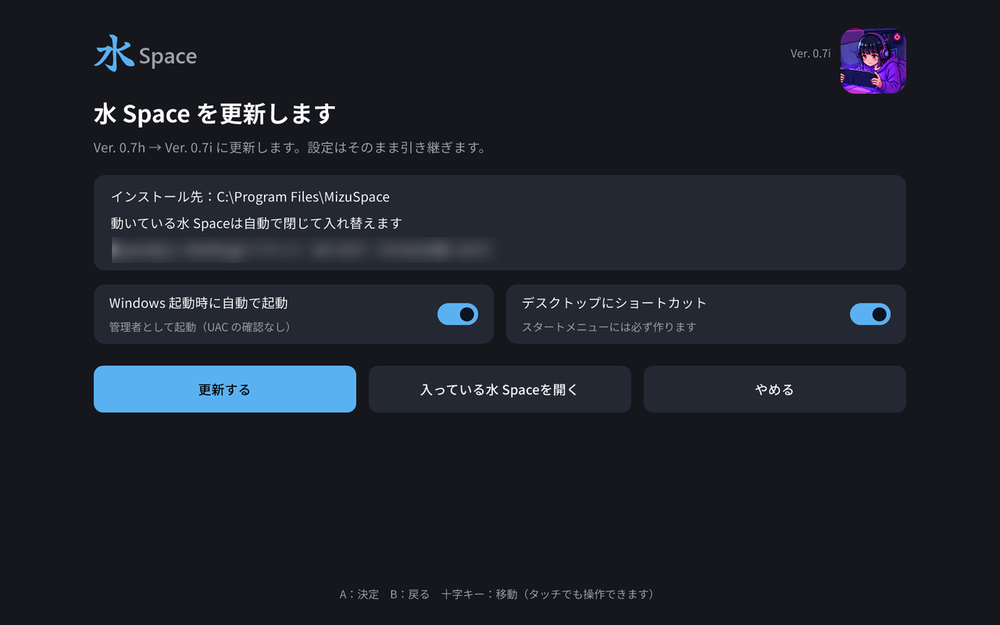

---

## 動作環境

| 項目 | 内容 |
|---|---|
| 対応機種 | **SuiPlay0X1（Windows 11）専用** |
| 注意 | SuiPlay0X1 以外の PC では起動しません |

---

## 更新履歴

新しい順に並べています。▶ を押すと各版の内容が開きます。

<b>Ver. 0.8 系</b>（2026/11）― FPS 制限

| 版 | 内容 |
|---|---|
| 0.8b | **FPS 制限**：クイック設定のスイッチでオン／オフ、30／40／45／60 FPS から選べるように |
| 0.8a | FPS 制限の準備：今の FPS 制限の状態を、クイック設定と動作チェックに表示 |

<b>Ver. 0.7 系</b>（2026/11）― ドライバチェック・背景画像・仕上げ

| 版 | 内容 |
|---|---|
| 0.7j | 消費電力の表示を改善。今の消費電力がすぐ分かるように |
| 0.7i | クイック設定の性能タブで、消費電力の数字が消えることがある不具合を修正 |
| 0.7h | 画面を ✕ で閉じた直後に、裏のゲームが誤って起動してしまう不具合を修正。水 Space の画面の上ではマウスカーソルを隠すように（マウスやリモート操作のときは表示、タッチには影響なし） |
| 0.7g | 背景の調整に「既定に戻す」を追加 |
| 0.7f | 背景のぼかしの強さを調整できるように（0〜100%） |
| 0.7e | 背景のボタンを、設定ページの「テーマ」の横に移動 |
| 0.7d | 背景の調整画面を追加（ホーム／クイック設定で別々に、見せる位置と拡大を選べる。仕上がりの見本付き）。クイック設定を開いたときに背景が半分しか出ない不具合を修正 |
| 0.7c | ホーム・クイック設定の背景画像に対応（ぼかし＋ガラス越しの見た目、ガラスの濃さ）。「このアプリについて」に開発ブランドとリンク、コピーライトを追加 |
| 0.7b | ドライバの状態を自動で診断（問題なし・古い・見つからない・エラー）。SuiPlay0X1 以外では起動しないように（アンインストールはどの PC でも可） |
| 0.7a | ドライバチェック画面を追加。機器ごとに公式のダウンロードページへ案内 |

<b>Ver. 0.6 系</b>（2026/10）― 多言語・パフォーマンス表示・ブランド

| 版 | 内容 |
|---|---|
| 0.6i | 「このアプリについて」を、角の丸い横長の小窓に一新 |
| 0.6h | ロゴの書体のクレジットを表示。設定から動作チェック・アンインストールを開けるように |
| 0.6g | 非公式キャラクターを「このアプリについて」とインストーラーに小さく表示 |
| 0.6f | 「SuiPlay0X1 用の非公式ランチャー」の表記を追加 |
| 0.6e | 新しいロゴ（筆文字の「水」＋「Space」）。どの言語でも「水 Space」と表示 |
| 0.6d | パフォーマンス表示に FPS を追加。ゲームを終えたら、コントローラー操作を元の状態に戻すように。インストーラーで前の版に戻せるように |
| 0.6c | パフォーマンス表示を追加（CPU・GPU・メモリ・消費電力・温度・電池・時刻。背景の濃さと表示位置を選べる） |
| 0.6b | 8 言語に対応（日本語・English・简体中文・繁體中文・한국어・Español・Français・Deutsch）。Windows の言語に合わせて自動で切り替え、設定で変更も可 |
| 0.6a | 本体のホームボタンでホーム画面を開けるように（ボタンの登録し直しも可） |

<b>Ver. 0.5 系</b>（2026/10）― 性能調整・インストーラー・改名

| 版 | 内容 |
|---|---|
| 0.5m | 古い版の自動起動が残っていると起動時にエラーが出る件に対処 |
| 0.5l | プリセット中は TDP スライダーを灰色にし、触るとカスタムに切り替わるように。設定の状態を「✓ 適用中」「↻ 適用しています…」「! エラー」の印で表示 |
| 0.5k | 性能調整の安定性を改善。起動時にコントローラーでのパソコン操作をいつもオンに |
| 0.5j | ボタンの割り当て画面を追加。ディスプレイキーボードをスイッチに。コントローラーのテストは開始ボタンで始まり、B 長押しで終了 |
| 0.5i | 性能調整とバイパス充電が同時に動いても衝突しないように。性能調整がうまくいかないときは自動で別の方式に切り替え |
| 0.5h | 動作チェック画面を追加（コントローラー・振動・水ボタン・状態をひとまとめに） |
| 0.5g | コントローラーでのマウス操作がかくつく件を修正し、なめらかに |
| 0.5f | **アプリ名を「水 Space」に変更**。インストーラーを内蔵（インストール・更新・入れ直し・アンインストール、「設定 → アプリ」に登録）。英語版 Windows でも文字化けしないように。以前の版の設定を引き継ぎ |
| 0.5e | バイパス充電に必要な部品が無いときの案内を追加 |
| 0.5d | 性能調整に必要な部品を公式の配布元から取得するボタンを追加 |
| 0.5c | 性能調整の方式を自動で選ぶように（W 単位で調整できる環境ならそれを、無理なら Windows の電源設定で） |
| 0.5b | Windows の電源設定だけで CPU を抑える方式を追加（追加の部品なしで使える） |
| 0.5a2 | 自動起動のオン／オフを、ホームとクイック設定の両方から切り替えられるように |
| 0.5a | 性能タブ：TDP の調整（プリセット・カスタム）、消費電力・CPU 温度の表示 |

<b>Ver. 0.4 系</b>（2026/10）― コントローラーでパソコン操作

| 版 | 内容 |
|---|---|
| 0.4a3 | 本体の水ボタンへの対応を改善 |
| 0.4a2 | 状態の診断表示を追加。Steam の新しい表紙画像に対応 |
| 0.4a | コントローラーでマウス・キーボード操作（スティックでカーソルとスクロール、ボタンでクリック、画面キーボード）。View＋Menu 長押しでオン／オフ。画面上部に短いお知らせ表示。カーソルの速さなどを調整可能 |

<b>Ver. 0.3 系</b>（2026/10）― ゲームランチャー

| 版 | 内容 |
|---|---|
| 0.3a2 | ゲームパッドでの項目移動の不具合を修正 |
| 0.3a | Steam・Epic Games・GOG のゲームを表紙付きで一覧にして起動。最近遊んだ順、ストアで絞り込み |

<b>Ver. 0.2 系</b>（2026/10）― 充電・画面・無線

| 版 | 内容 |
|---|---|
| 0.2c | Wi-Fi・Bluetooth・機内モードの切り替え |
| 0.2b2 | 画面が真っ暗になる組み合わせのリフレッシュレートを出さないように |
| 0.2b | 明るさ・音量・リフレッシュレート・解像度の変更（時間内に確定しないと元に戻る安全設計） |
| 0.2a | バイパス充電・充電上限（抜き差しやスリープ復帰で自動でかけ直し、終了時は通常充電に戻す）。SuiPlay0X1 専用の安全ロック。Windows 起動時の自動起動 |

<b>Ver. 0.1 系</b>（2026/10）― 土台・見た目

| 版 | 内容 |
|---|---|
| 0.1e3 | 振動の「中」を、実機でちょうど良かった強さに調整 |
| 0.1e2 | 振動の強さ（弱・中・強）と振動テスト |
| 0.1e | テーマ（システム・ダーク・ライト）。Windows のダーク／ライトに追従 |
| 0.1d2 | 本体の水ボタンでクイック設定を開けるように。スライダーは A でつかんでから ←→ で操作 |
| 0.1d | ゲームパッド操作（十字キーで移動・A 決定・B 戻る・LB/RB ページ切り替え）、操作音、操作時の振動 |
| 0.1c3 | しずくのロゴ。文字をなめらかな表示に、書体を選べるように |
| 0.1c2 | クイック設定を左の縦タブ（性能・デバイス・操作・電池・システム）＋右の項目リストに作り直し |
| 0.1c | クイック設定にタイルと明るさ・音量のスライダー |
| 0.1b | ホーム画面に左の縦メニューとページごとのカード |
| 0.1a | 最初の版。ホーム画面と、右からスライドするクイック設定の枠、時刻と電池残量の表示 |

---

## 今後の予定

🌈 **現在、スティックの LED ライティング（ライトの色の変更）に挑戦中です。** お楽しみに！

---

## ご注意
- 本アプリは個人が開発した**非公式**のアプリです。SuiPlay0X1 のメーカーとは関係ありません。
- BIOS などのファームウェアを書き換えることはありません。
- ご利用は自己責任でお願いします。

---

## English

**水 Space (MizuSpace)** is an unofficial launcher for the SuiPlay0X1 running Windows 11.

- **Home screen** – launch your Steam / Epic Games / GOG games with cover art
- **Quick settings** – press the "水" button for a slide-in panel: performance (TDP presets), FPS limit (30/40/45/60), brightness, volume, refresh rate, resolution, Wi-Fi / Bluetooth / airplane mode
- **Bypass charging & charge limit** (60–90%) – reduces battery wear while playing plugged in
- **Desktop control with the gamepad** – remappable buttons, on-screen keyboard
- **Performance overlay** – FPS, CPU, GPU, RAM, power, temperature, battery, clock
- **Device & driver check** – links to official download pages (never installs drivers by itself)
- **Themes & wallpaper**, **8 languages**, one-exe installer
- Runs **only on SuiPlay0X1**. Currently in development (Ver. 0.8 series).

This is an unofficial app made by an individual developer and is not affiliated with the device manufacturer.

<table><tr>
<td>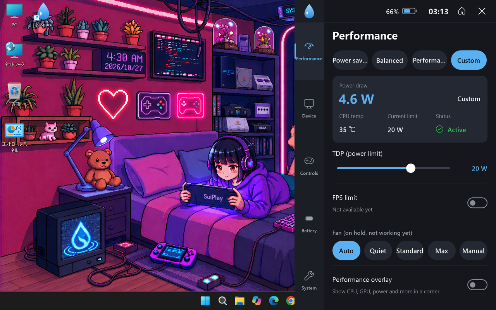</td>
<td>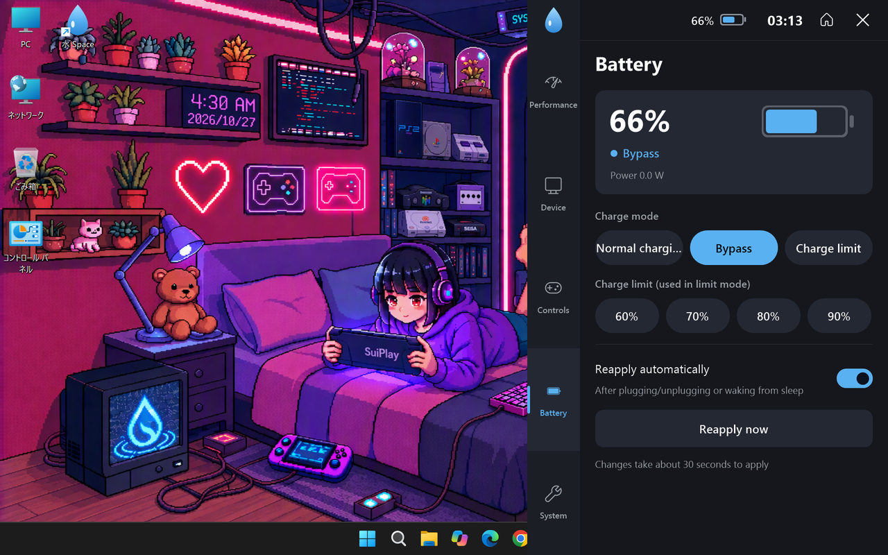</td>
</tr><tr>
<td>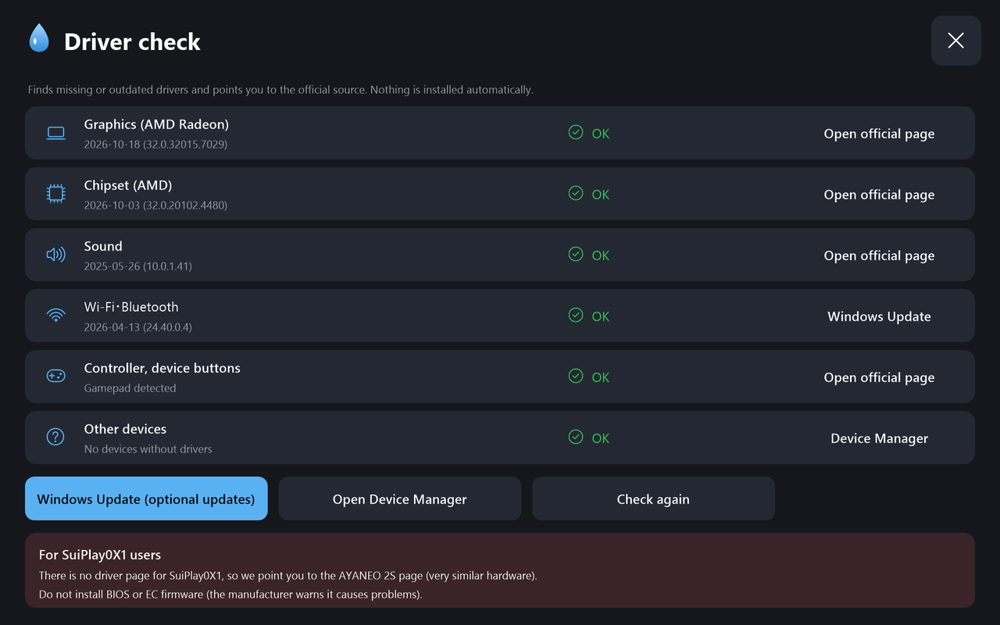</td>
<td>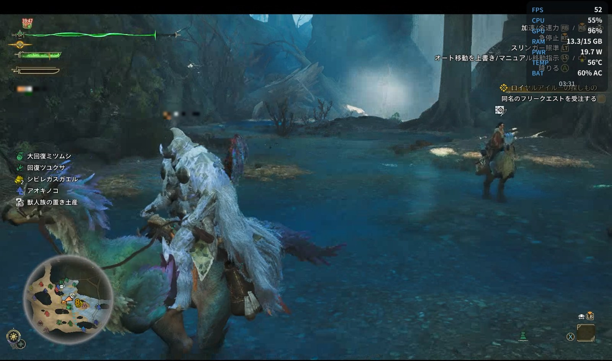</td>
</tr></table>

**Coming next:** we're working on stick LED lighting (changing the light color). Stay tuned!

---

## 简体中文

**水 Space（MizuSpace）** 是一款为运行 Windows 11 的 SuiPlay0X1 打造的非官方启动器。

- **主页** – 带封面显示 Steam / Epic Games / GOG 的游戏，并可直接启动
- **快捷设置** – 按下"水"键，面板从屏幕右侧滑出：性能（TDP 预设）、帧率限制（30/40/45/60）、亮度、音量、刷新率、分辨率、Wi-Fi / 蓝牙 / 飞行模式
- **旁路充电与充电上限**（60–90%）– 插着充电器游玩时，减轻电池负担
- **用手柄操作电脑** – 可自定义按键，屏幕键盘
- **性能显示** – FPS、CPU、GPU、内存、功耗、温度、电量、时间
- **设备与驱动检查** – 引导至官方下载页面（不会自动安装驱动）
- **主题与壁纸**、**8 种语言**、单个 exe 即可安装
- **仅支持 SuiPlay0X1**。目前正在开发中（Ver. 0.8 系列）。

本应用由个人开发者制作，属于非官方应用，与设备制造商无关。

**今后的计划：** 正在挑战摇杆 LED 灯光（更改灯光颜色）。敬请期待！

---

## 한국어

**水 Space(MizuSpace)**는 Windows 11을 설치한 SuiPlay0X1용 비공식 런처입니다.

- **홈 화면** – Steam / Epic Games / GOG 게임을 표지와 함께 표시하고 바로 실행
- **빠른 설정** – "水" 버튼을 누르면 화면 오른쪽에서 패널이 나타납니다: 성능(TDP 프리셋), FPS 제한(30/40/45/60), 밝기, 음량, 주사율, 해상도, Wi-Fi / Bluetooth / 비행기 모드
- **바이패스 충전·충전 상한**(60–90%) – 충전기를 연결한 채 플레이할 때 배터리 부담을 줄입니다
- **컨트롤러로 PC 조작** – 버튼 재지정, 화상 키보드
- **성능 표시** – FPS, CPU, GPU, 메모리, 소비 전력, 온도, 배터리, 시각
- **장치·드라이버 점검** – 공식 다운로드 페이지로 안내(드라이버를 자동으로 설치하지 않음)
- **테마와 배경 화면**, **8개 언어**, exe 하나로 설치
- **SuiPlay0X1 전용**입니다. 현재 개발 중(Ver. 0.8 시리즈).

개인 개발자가 만든 비공식 앱이며, 기기 제조사와는 관계가 없습니다.

**앞으로의 계획:** 스틱 LED 조명(조명 색상 변경)에 도전하고 있습니다. 기대해 주세요!

---

## Links
- YouTube: https://www.youtube.com/@SoaAlch
- X: https://x.com/SoaAlch

---

© 2026 SoaAlch. All rights reserved.
無断での転載・再配布・改変を禁止します。詳しくは [LICENSE](LICENSE) をご覧ください。
